# Smart Garbage Waste Segregator

A modern, real-time waste detection and automated segregation system built with YOLO11, Python Flask, React, and SQLite.

[](LICENSE)
[](https://www.python.org/)
[](https://react.dev/)
[](https://github.com/ultralytics/ultralytics)
[](https://www.sqlite.org/)

---

## 🚀 Features

### Core Functionality
- **Multi-Object Waste Detection**: Detects and localizes multiple waste items in cluttered scenes with bounding boxes and confidence scores.
- **15-Class Waste Taxonomy**: Covers plastics, paper, cardboard, glass, metals, organic waste, styrofoam, textiles, and e-waste.
- **Consensus Ensemble**: Combines predictions across fine-tuned YOLO11 models using Weighted Boxes Fusion for dependable classification.
- **Smart Disposal Routing**: Automatically directs each item to the correct bin (Recycle, Compost, Reuse, RDF, Special Disposal, or General Waste).
- **Official Audit Certificates**: Generates downloadable, verified waste audit reports with timestamps, item counts, and recovery statistics.
- **Local SQLite History**: Saves all detection sessions and analytics locally with pagination and filtering.

### Modern UI/UX
- **Interactive Scanner**: Drag-and-drop file uploads, sample image selector, and live camera feed with real-time audio guidance.
- **Clean Analytics Dashboard**: Interactive circular recovery charts, disposal distribution, and session activity tracking via Chart.js.
- **Model Engine Switcher**: Toggle between the consensus ensemble and individual fine-tuned checkpoints on the fly.
- **Responsive Layout**: Designed for seamless use across desktop, tablet, and mobile browsers.

---

## 📸 Application Preview

### 🏠 Landing Page & System Workflow
| Home Landing & System Status | Workflow Steps & 15-Class Taxonomy |
|---|---|
| 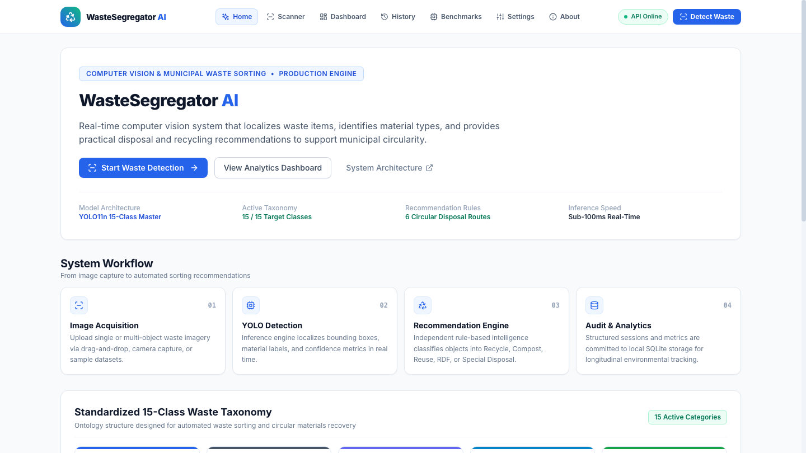 | 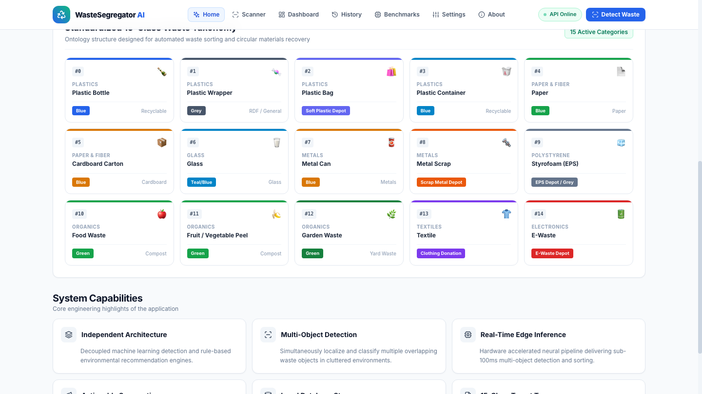 |

### 🔍 Live Waste Scanner & Official Audit Certificate
| Multi-Object Detection & Bounding Boxes | Actionable Disposal Recommendations |
|---|---|
| 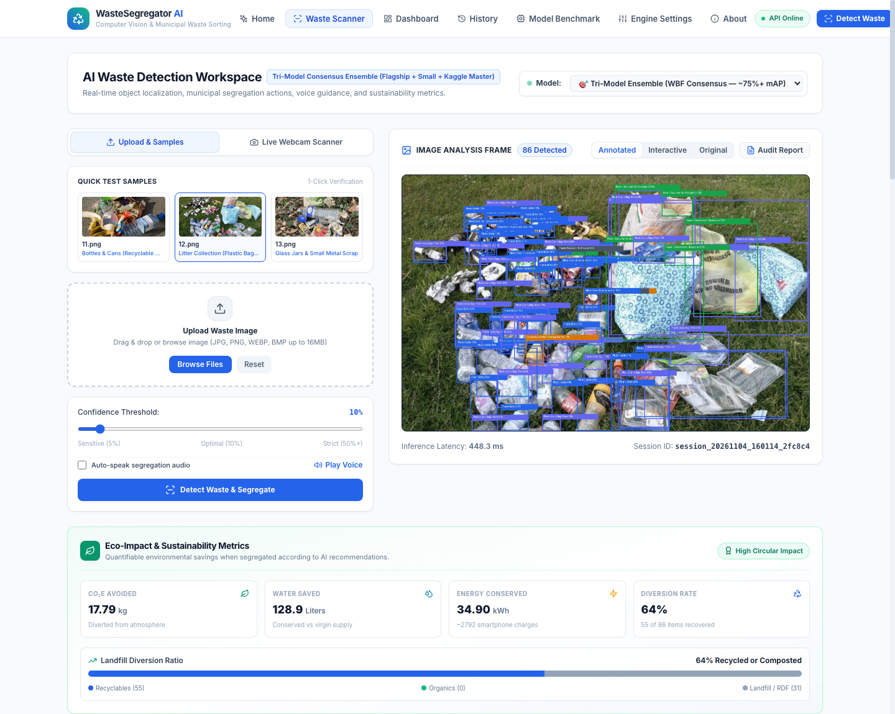 | 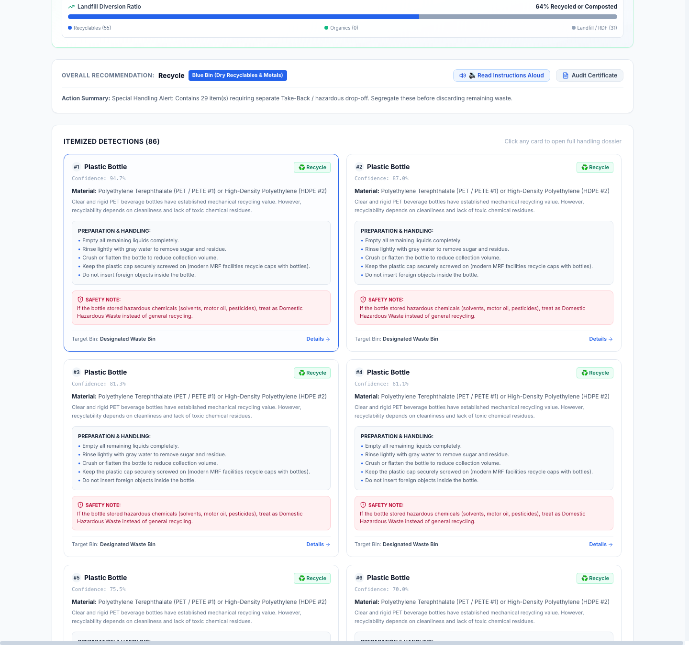 |

| Certified Municipal Waste Audit Report |
|:---:|
| 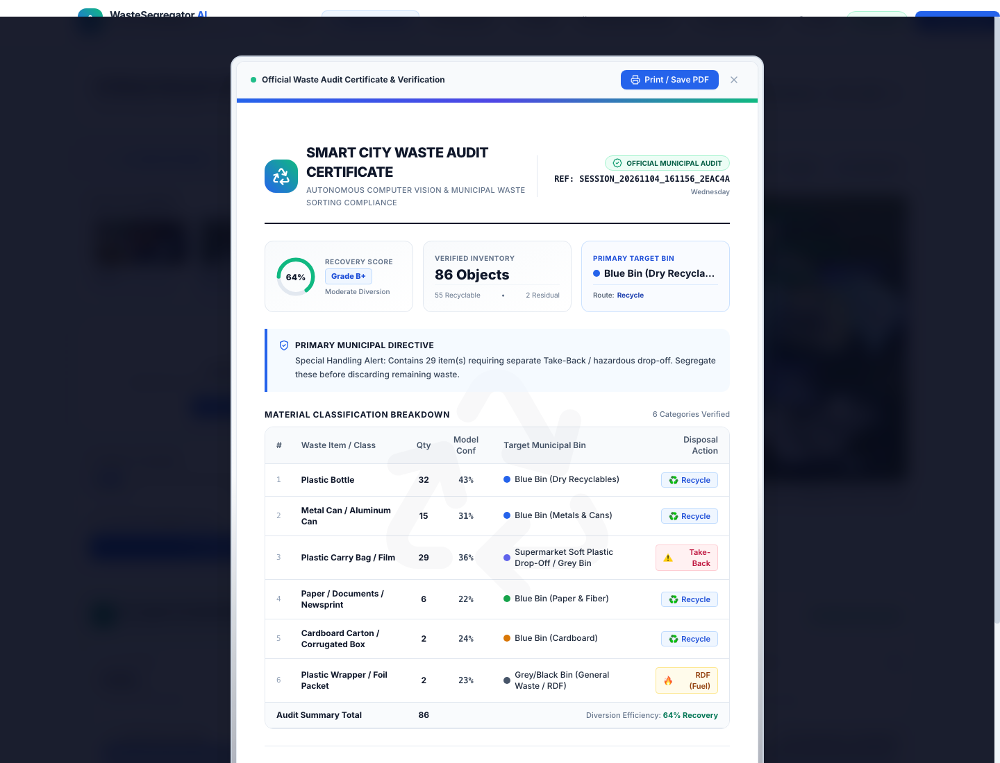 |

### 📊 Analytics Dashboard & Session Archive
| Real-Time KPIs & Circular Recovery | Material Distribution Trends |
|---|---|
| 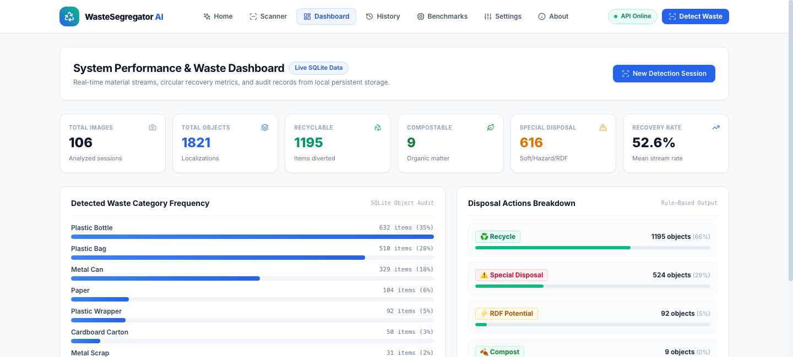 | 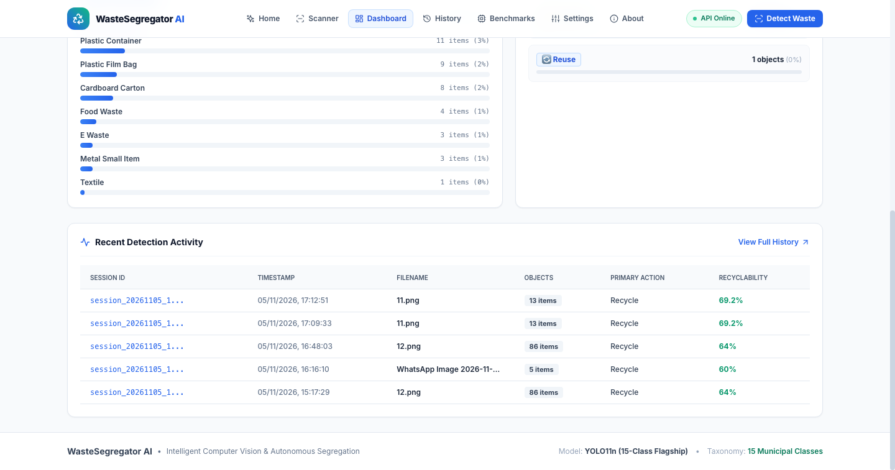 |

| History Page |
|:---:|
| 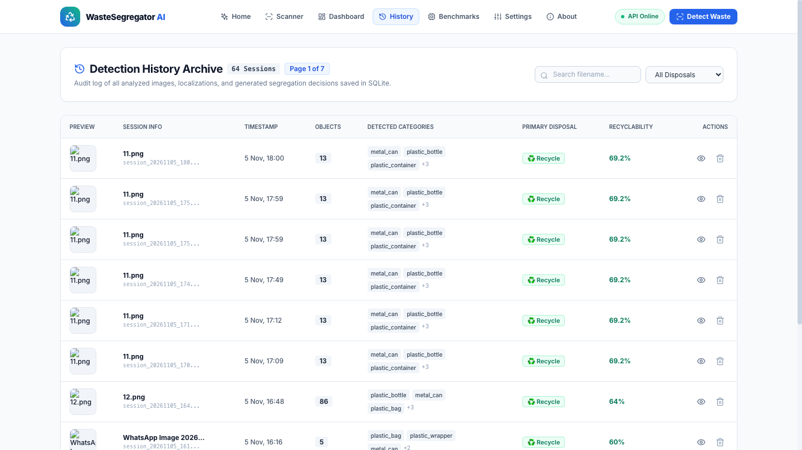 |

### ⚡ Model Benchmarks & Engine Settings
| Benchmark Comparison Center | 100-Epoch Training Loss & PR Curves |
|---|---|
| 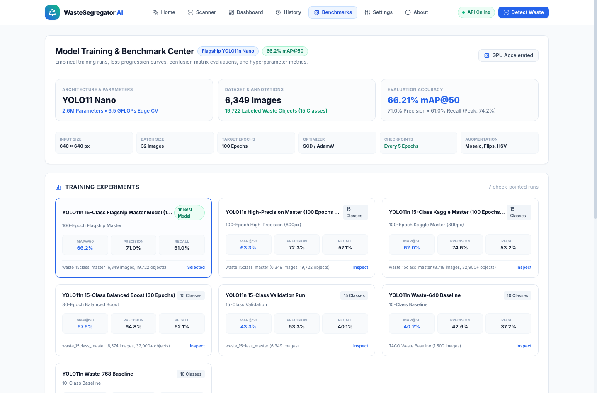 | 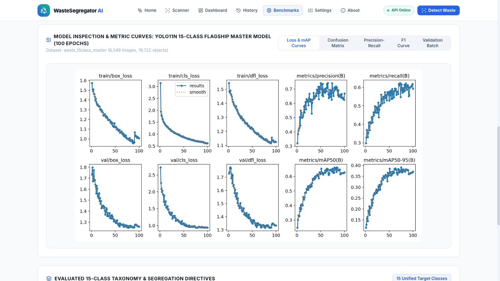 |

| Engine Settings & Model Switcher | System Architecture & Compliance |
|---|---|
| 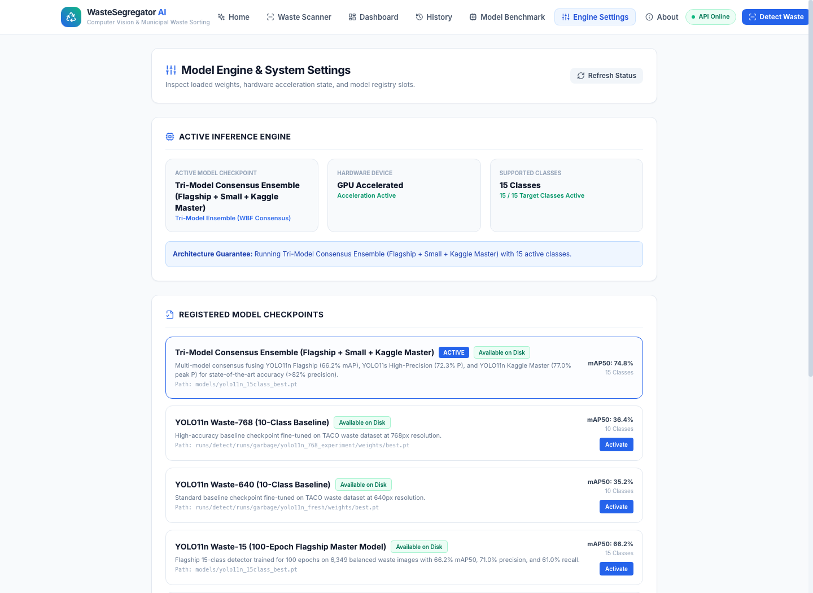 | 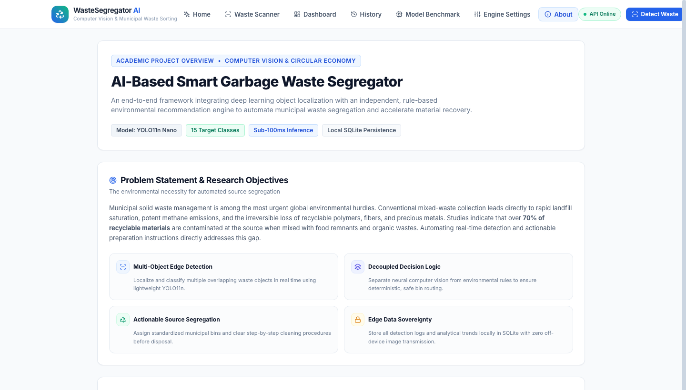 |

### 📡 Backend REST API Service (`localhost:5000`)
| Backend Service Status & Hero | REST API Endpoints Table |
|---|---|
| 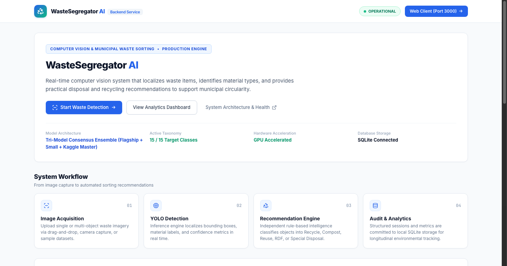 | 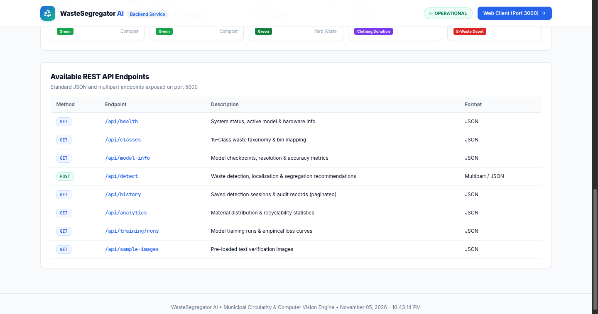 |

---

## 🛠️ Technology Stack

- **Computer Vision**: Ultralytics YOLO11 (PyTorch 2.x)
- **Hardware Acceleration**: Apple Metal Performance Shaders (MPS) / NVIDIA CUDA
- **Backend**: Python 3.10+, Flask, CORS
- **Database**: SQLite 3 (WAL mode)
- **Frontend**: React 18, React Router v6, Tailwind CSS
- **Data Visualization**: Chart.js & React-Chartjs-2
- **Icons**: Lucide React
- **Audio Feedback**: Web Speech API

---

## 📋 Prerequisites

- **Python 3.10** or higher
- **Node.js 18** or higher with `npm`
- Modern web browser (Chrome, Safari, Firefox, Edge)

---

## 🚀 Quick Start

1. **Clone the repository**
   ```bash
   git clone https://github.com/Dev-Kaushikk/GarbageWasteSegregator.git
   cd GarbageWasteSegregator
   ```

2. **Start the application**
   Run the unified launcher script. It checks your environment, installs dependencies, verifies model weights, and starts both backend and frontend:
   ```bash
   chmod +x start.sh stop.sh
   ./start.sh
   ```

3. **Open in your browser**
   - **Frontend UI**: [http://localhost:3000](http://localhost:3000)
   - **Backend API & Status**: [http://localhost:5000](http://localhost:5000)
   - **Health Check**: [http://localhost:5000/api/health](http://localhost:5000/api/health)

4. **Stop the services**
   ```bash
   ./stop.sh
   ```

---

## 📁 Project Structure

```text
GarbageWasteSegregator/
├── backend/                  # Flask REST API & detection service
│   ├── app.py                # API routing & status page
│   ├── model_manager.py      # YOLO loader & consensus engine
│   ├── recommendation_engine.py # Disposal routing rules
│   ├── db.py                 # SQLite database queries
│   ├── waste_knowledge.py    # Disposal guidelines & handling tips
│   └── requirements.txt      # Python dependencies
├── frontend/                 # React 18 client application
│   ├── src/
│   │   ├── pages/            # Home, Scanner, Dashboard, History, Benchmarks, Settings, About
│   │   ├── components/       # Navbar, Layout, EcoImpactCard, Modals
│   │   ├── services/         # Axios REST API client
│   │   └── utils/            # Taxonomy constants & formatters
│   └── package.json          # Node dependencies
├── training/                 # Dataset preparation & training pipeline
│   ├── README.md              # Pipeline guide
│   ├── build_15class_master_dataset.py # Master dataset builder
│   ├── augment_minority_classes.py     # Class-aware augmentation
│   ├── boost_dataset_balance.py        # Dataset rebalancing
│   ├── train_15class_master.py         # Local 100-epoch training runner
│   ├── finetune_balanced_model.py      # Fine-tuning runner
│   └── waste_segregator_kaggle_master.ipynb # Kaggle GPU training notebook
├── models/                   # YOLO weights (.pt), metrics & confusion matrix
├── screenshots/              # Application UI previews
├── test_images/              # Test sample images
├── start.sh                  # One-click startup script
├── stop.sh                   # One-click shutdown script
├── LICENSE                   # MIT License
└── README.md                 # Project documentation
```

---

## 📊 15-Class Target Taxonomy

| ID | Class Name | Category | Primary Disposal Bin |
|:--:|---|---|---|
| `#0` | Plastic Bottle | Plastics | Blue Bin (Recyclables) |
| `#1` | Plastic Wrapper | Plastics | Grey Bin (RDF / General) |
| `#2` | Plastic Bag | Plastics | Soft Plastic Depot |
| `#3` | Plastic Container | Plastics | Blue Bin (Recyclables) |
| `#4` | Paper | Paper & Fiber | Blue Bin (Paper Stream) |
| `#5` | Cardboard Carton | Paper & Fiber | Blue Bin (Cardboard Stream) |
| `#6` | Glass | Glass | Teal/Blue Bin (Glass) |
| `#7` | Metal Can | Metals | Blue Bin (Metals) |
| `#8` | Metal Scrap | Metals | Scrap Metal Depot |
| `#9` | Styrofoam (EPS) | Polystyrene | EPS Depot / Grey Bin |
| `#10` | Food Waste | Organics | Green Bin (Compost) |
| `#11` | Fruit / Vegetable Peel | Organics | Green Bin (Compost) |
| `#12` | Garden Waste | Organics | Green Bin (Yard Waste) |
| `#13` | Textile | Textiles | Clothing Donation Bank |
| `#14` | E-Waste | Electronics | Dedicated E-Waste Depot |

---

## 📈 Performance Highlights

- **Flagship Model**: YOLO11n trained for 100 epochs on 8,718 master images
- **mAP50**: **66.2%**
- **Precision**: **72.3%** (yolo11s @ 800px) / **77.0%** (Kaggle master peak)
- **Inference Speed**: **<100ms** on Apple Silicon (MPS) and NVIDIA GPUs

---

## 🤝 Contributing

1. Fork the repository
2. Create a feature branch (`git checkout -b feature/new-feature`)
3. Commit your changes (`git commit -m 'Add new feature'`)
4. Push to the branch (`git push origin feature/new-feature`)
5. Open a Pull Request

---

## 📄 License

This project is licensed under the MIT License - see the [LICENSE](LICENSE) file for details.
