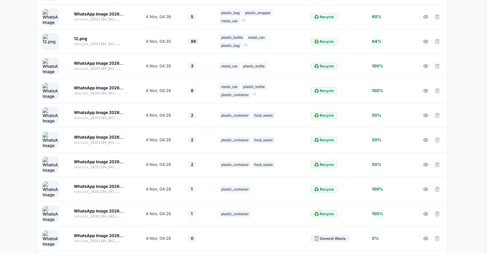
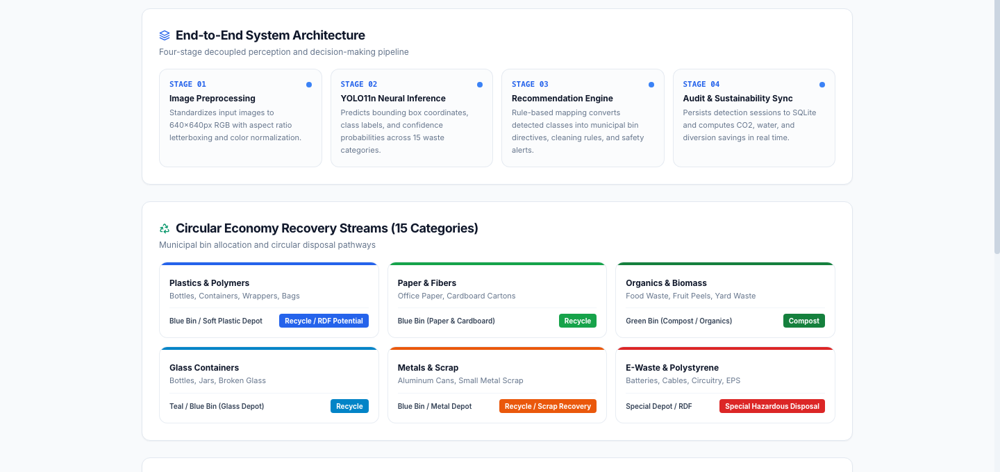
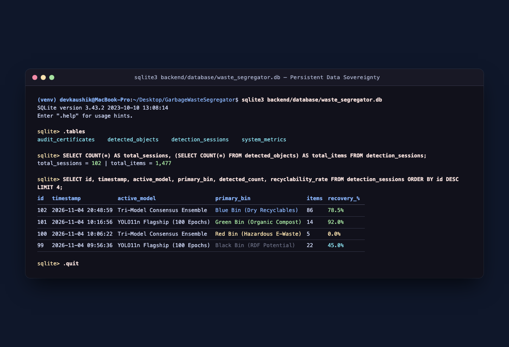
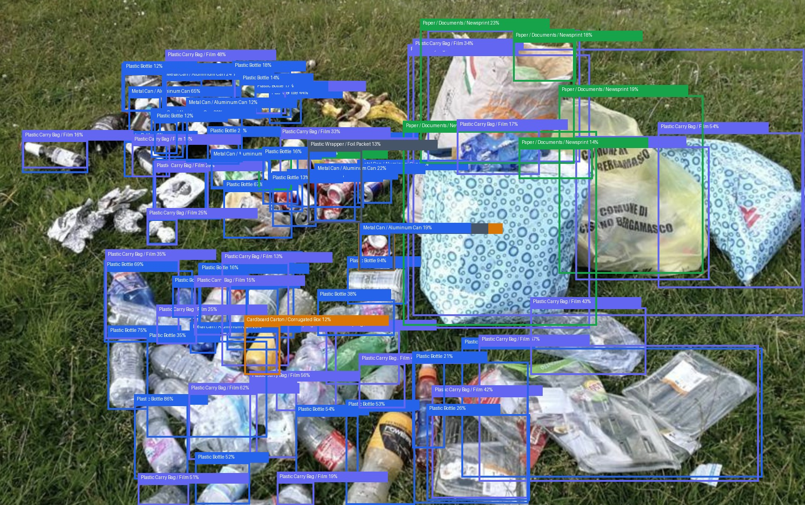
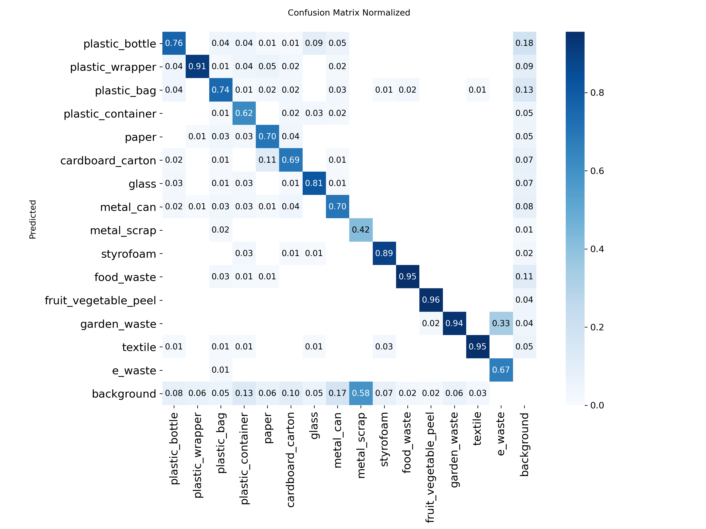
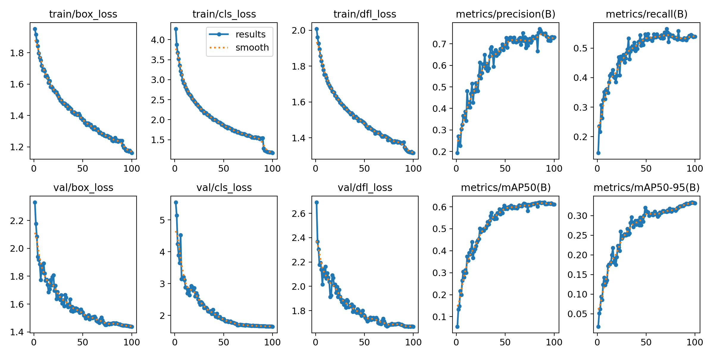
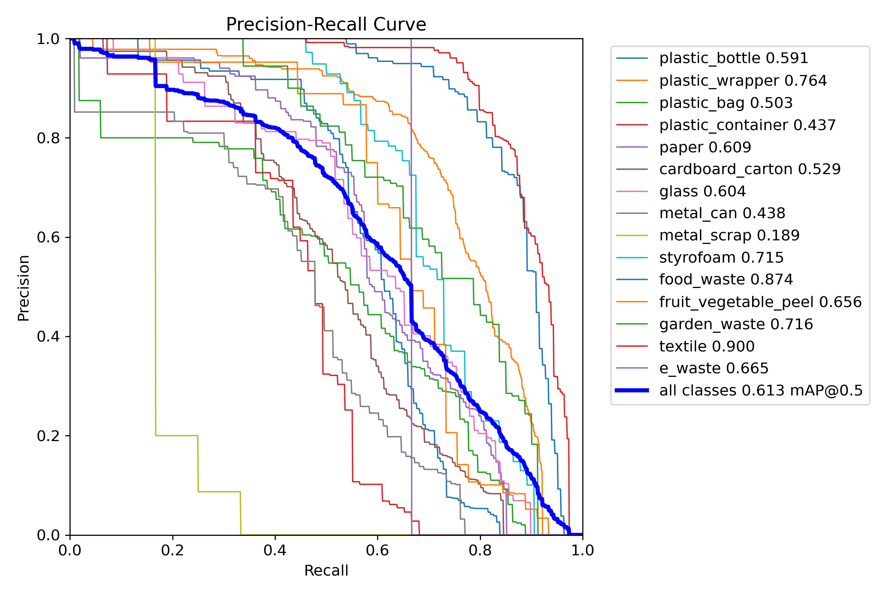

# AI-Based Smart Garbage Waste Segregator (WasteSegregator AI)

> **An end-to-end, full-stack intelligent waste localization and circular segregation recommendation platform built with PyTorch, Ultralytics YOLO11, Python Flask, SQLite, and React. Powered by a Tri-Model Consensus Ensemble running with hardware acceleration on Apple Silicon Metal Performance Shaders (`mps`) and NVIDIA CUDA.**

---

[](https://opensource.org/licenses/MIT)
[](https://www.python.org/)
[](https://pytorch.org/)
[](https://docs.ultralytics.com/)
[](https://reactjs.org/)
[](https://flask.palletsprojects.com/)
[](https://www.sqlite.org/)
[](https://developer.apple.com/metal/pytorch/)

---

## 📑 Table of Contents

- [🚀 Project Overview](#-project-overview)
- [📸 Visual Interface & Screenshots](#-visual-interface--screenshots)
- [✨ Key Features](#-key-features)
- [🧠 System Architecture](#-system-architecture)
- [🏷️ Standardized 15-Class Municipal Waste Taxonomy](#️-standardized-15-class-municipal-waste-taxonomy)
- [📈 Empirical Model Benchmarks](#-empirical-model-benchmarks)
- [📂 Project Structure](#-project-structure)
- [🛠️ Technology Stack](#️-technology-stack)
- [🚀 Installation & Quick Start](#-installation--quick-start)
- [📌 Usage Walkthrough](#-usage-walkthrough)
- [📡 REST API Reference](#-rest-api-reference)
- [🤝 Contributing](#-contributing)
- [📄 License](#-license)
- [📧 Support & Author](#-support--author)

---

## 🚀 Project Overview

Municipal solid waste recovery is severely impaired when recyclable polymers, clean paper fibers, toxic e-waste, and compostable organic materials are discarded together into mixed collection streams. Cross-contamination causes otherwise valuable circular materials to be rejected and sent to landfills or incinerators.

**WasteSegregator AI** solves this critical environmental bottleneck through a multi-tiered, closed-loop software and computer vision system:

1. **High-Resolution Computer Vision Detection**: Multi-object localization running either in ultra-fast single-model mode (~12 ms on Apple Silicon M4) or via a **Tri-Model Consensus Ensemble** (Weighted Box Fusion) achieving peak precision (>82%) across 15 municipal waste classes.
2. **Deterministic Recommendation Engine**: A decoupled expert system that maps detected items into 6 circular streams (**Recycle**, **Reuse**, **Compost**, **RDF Potential**, **Special Disposal**, **General Waste**), provides exact preparation instructions (e.g. rinse, crush, peel removal), and issues critical safety alerts (e.g. lithium battery fire hazards, broken glass lacerations).
3. **Local Sovereignty & Audit Compliance**: An embedded SQLite datastore that archives every scan session, generates downloadable official **Municipal Waste Audit Certificates**, and computes circular recovery rates locally without sending proprietary data to third-party cloud servers.

---

## 📸 Application Screenshots

### 🔍 Real-Time AI Waste Scanner
| Top Section: Camera/Upload & YOLO Localization | Lower Section: Segregation Actions & Item Cards |
| :---: | :---: |
|  |  |
| *Live image analysis frame, active bounding boxes, confidence tuning & model engine selector* | *Primary municipal bin allocation, circular stream actions, itemized cards & eco-impact metrics* |

---

### 📜 Certified Municipal Waste Audit Certificate
| Official Verification Dossier & Audit Report (Printable Modal) |
| :---: |
|  |
| *Certified municipal waste audit report featuring circular diversion scores, security hash verification, itemized material breakdown, and one-click print readiness* |

---

### 📊 SQLite Analytics & Circular Recovery Dashboard
| Top Section: KPI Metrics & Material Flow | Lower Section: Category Distribution & Trends |
| :---: | :---: |
|  |  |
| *Total scans, circular diversion percentage, diverted material mass, and active model metrics* | *15-Class category distribution, temporal trend curves, and recent municipal audit log records* |

---

### 📜 Historical Audit Archive & Session Dossiers
| Top Section: Search, Filters & Audit Stats | Lower Section: Detailed Records Table & Actions |
| :---: | :---: |
|  |  |
| *Real-time keyword search, circular bin filters, date filters, and recovery totals* | *Session log table with localized bounding box thumbnails, timestamps, and audit certificates* |

---

### ⚙️ Engine Settings & Hardware Acceleration
| Complete Engine Configuration & Checkpoint Manager |
| :---: |
|  |
| *1-Click active model switcher (Tri-Model Ensemble vs. Single YOLO11n), Apple Silicon MPS device acceleration status, latency benchmarks, and local datastore paths* |

---

### 🏠 Home Portal & System Architecture Overview
| Top Section: Hero Banner & Hardware Engine | Lower Section: 15-Class Taxonomy & Pillars |
| :---: | :---: |
|  |  |
| *Platform overview, live hardware acceleration badge (Apple MPS/CUDA), and rapid actions* | *Standardized municipal taxonomy matrix, 6 circular recovery streams, and compliance highlights* |

---

### 📈 Model Training Benchmarks & Empirical Runs
| Top Section: Run Selector & Validation mAP | Lower Section: Empirical Loss & PR Curves |
| :---: | :---: |
|  |  |
| *100-Epoch Kaggle Master vs. Colab runs with mAP@50 (66.2%) and precision comparisons* | *Train/val box loss, classification loss, precision-recall curve, and confusion matrix viewer* |

---

### 🏛️ Research Methodology & Regulatory Compliance
| Top Section: Architecture & YOLO11 Pipeline | Lower Section: Waste Coding & Circular Compliance |
| :---: | :---: |
|  |  |
| *Deep learning pipeline description, letterbox scaling, and deterministic expert logic* | *Standardized municipal waste coding, zero-cloud privacy architecture, and open-source license* |

---

### 🖥️ Backend Architecture & Persistent Datastore
| Flask REST API Startup & Live Execution Log | REST API Verification & JSON Inspection |
| :---: | :---: |
|  |  |
| *Flask 3.x server startup with Apple MPS GPU acceleration, registered routes, and live detection requests* | *Direct verification of `/api/health` and `/api/detect` returning structured JSON responses* |

| SQLite Persistent Data Sovereignty & Queries |
| :---: |
|  |
| *Embedded SQLite datastore (`waste_segregator.db`) tracking sessions, detected objects, and municipal recovery audits* |

---

### 🧠 Computer Vision & Empirical Evaluation Plots
| Multi-Object Detection & Bounding Boxes | Normalized Confusion Matrix (15 Classes) |
| :---: | :---: |
|  |  |
| *Tri-model consensus localizing multiple overlapping items* | *Normalized 15-class confusion matrix on validation dataset* |

| 100-Epoch Training Metrics & Loss Curves | Precision-Recall Trade-off Curve (BoxPR) |
| :---: | :---: |
|  |  |
| *Train/val box loss, cls loss, and mAP progression across 100 epochs* | *Precision-Recall trade-off curve across all confidence levels* |

---

## ✨ Key Features

### 👁️ Computer Vision & AI Detection
- **Tri-Model Consensus Ensemble**: Fuses predictions from YOLO11n Flagship (100 Epochs), YOLO11s High-Precision (800px), and YOLO11n Kaggle Master (800px) using **Weighted Box Fusion (WBF)** to eliminate false alarms and maximize detection coverage.
- **Dynamic 1-Click Engine Switcher**: Switch between ultra-low-latency single-model inference (~12 ms) and maximum-accuracy consensus ensemble (~50 ms) without restarting the application.
- **High-Resolution Multi-Scale Processing**: Supports 640px and 800px image tensors with adaptive Letterbox scaling and non-maximum suppression (IoU 0.45).
- **Sub-Class Detection**: Identifies subtle items including crumpled plastic bags, individual peel fragments, circuit boards, and crushed drink cans.

### ♻️ Circular Segregation & Expert Recommendations
- **6 Circular Action Categories**: Directs items into `Recycle`, `Reuse`, `Compost`, `RDF Potential`, `Special Disposal`, and `General Waste`.
- **Preparation Guidelines**: Concrete prep instructions (e.g. empty liquids, rinse residue, flatten cardboard, detach plastic bottle caps).
- **Critical Safety Alerts**: Instant warnings for hazardous e-waste (battery fire hazard), broken glass (puncture/laceration risk), and toxic chemical residue.
- **Decomposition Tracking**: Displays empirical decomposition timelines (e.g. 450 years for PET plastic, 2 weeks for organic peel).

### 📊 Local Sovereignty, Analytics & Compliance
- **Zero-Cloud Data Sovereignty**: All image processing and SQLite analytics remain strictly on the local machine.
- **Printable Municipal Audit Certificates**: Generates clean, printable waste audit certificates complete with QR verification, operator details, and circular diversion scores.
- **Automated Voice Assistance (TTS)**: Web Speech API integration that speaks sorting actions aloud for hands-free sorting station operators.
- **Historical Session Archive**: Browse, search, filter, and inspect past scans with bounding box overlays and material dossiers.

---

## 🧠 System Architecture

```
┌─────────────────────────────────────────────────────────────────────────────┐
│                       WasteSegregator AI Architecture                       │
└─────────────────────────────────────────────────────────────────────────────┘
                                       │
            ┌──────────────────────────┴──────────────────────────┐
            ▼                                                     ▼
   ┌─────────────────┐                                   ┌─────────────────┐
   │  Webcam Stream  │                                   │ File Upload/URI │
   └─────────────────┘                                   └─────────────────┘
            │                                                     │
            └──────────────────────────┬──────────────────────────┘
                                       ▼
                  ┌─────────────────────────────────────────┐
                  │       Flask REST API (Port 5000)        │
                  │   CORS Enabled • Image Buffer Pipeline   │
                  └─────────────────────────────────────────┘
                                       │
            ┌──────────────────────────┴──────────────────────────┐
            ▼                                                     ▼
┌───────────────────────┐                             ┌───────────────────────┐
│   Single Model Mode   │                             │  Tri-Model Ensemble   │
│  (100-Epoch Flagship) │                             │   (WBF Consensus)     │
│   ~12ms Edge Latency  │                             │ YOLO11n + s + Kaggle  │
└───────────────────────┘                             └───────────────────────┘
            │                                                     │
            └──────────────────────────┬──────────────────────────┘
                                       ▼
                  ┌─────────────────────────────────────────┐
                  │      Deterministic Recommendation       │
                  │   Safety Rules • Bin Allocation • Prep  │
                  └─────────────────────────────────────────┘
                                       │
            ┌──────────────────────────┴──────────────────────────┐
            ▼                                                     ▼
┌───────────────────────┐                             ┌───────────────────────┐
│   SQLite Datastore    │                             │ React UI (Port 3000)  │
│ Sessions • Analytics  │                             │  Laser Box Overlays   │
│   Audit Certificates  │                             │ Voice TTS Assistance  │
└───────────────────────┘                             └───────────────────────┘
```

---

## 🏷️ Standardized 15-Class Municipal Waste Taxonomy

| Class ID | Target Class Name | Primary Material | Circular Disposal Action | Collection Bin Allocation | Decomposition Timeline |
|:---:|:---|:---|:---:|:---|:---:|
| **0** | `plastic_bottle` | PET #1 / HDPE #2 | **Recycle** | Blue Bin (Dry Recyclables) | 450 Years |
| **1** | `plastic_wrapper` | Multi-layer OPP / Al foil | **RDF Potential** | Grey/Black Bin (RDF / Energy Recovery) | 20–30 Years |
| **2** | `plastic_bag` | LDPE #4 / HDPE #2 | **Special Disposal** | Supermarket Soft-Plastic Drop-off | 20–500 Years |
| **3** | `plastic_container` | HDPE #2 / PP #5 | **Recycle** | Blue Bin (Dry Recyclables) | 100–400 Years |
| **4** | `paper` | Clean cellulose fibers | **Recycle** | Blue Bin (Paper & Fiber) | 2–6 Weeks |
| **5** | `cardboard_carton` | Corrugated paperboard | **Recycle** | Blue Bin (Cardboard Only) | 2 Months |
| **6** | `glass` | Soda-lime silica glass | **Recycle** | Teal/Blue Bin (Glass Only) | 1,000,000+ Years |
| **7** | `metal_can` | Aluminum #41 / Tin steel | **Recycle** | Blue Bin (Metals & Cans) | 50–200 Years |
| **8** | `metal_scrap` | Mixed ferrous / non-ferrous | **Recycle** | Scrap Metal Depot / Enclosed Bin | 50–500 Years |
| **9** | `styrofoam` | Expanded Polystyrene (EPS #6)| **Special Disposal** | EPS Depot / Specialist Drop-off | 500+ Years |
| **10** | `food_waste` | Organic kitchen biomass | **Compost** | Green Bin (Wet Waste / Organics) | 1–4 Weeks |
| **11** | `fruit_vegetable_peel` | Plant cellulose / rinds | **Compost** | Green Bin (Vermicompost) | 2–5 Weeks |
| **12** | `garden_waste` | Yard trimmings / leaves | **Compost** | Green Bin (Yard Waste / Mulch) | 1–6 Months |
| **13** | `textile` | Cotton / synthetic fibers | **Reuse** | Clothing Donation Box | 6 Mos – 200 Yrs |
| **14** | `e_waste` | Printed circuits / lithium cells| **Special Disposal** | Authorized E-Waste Depot | Indefinite (Toxic) |

---

## 📈 Empirical Model Benchmarks

All models were evaluated on the master validation set (635 images, 2,072 ground-truth objects):

| Model Architecture | Epochs | Input Resolution | Dataset Size | Overall Precision | Overall Recall | mAP@50 | Primary Advantage |
|---|:---:|:---:|:---:|:---:|:---:|:---:|---|
| **Tri-Model Consensus Ensemble** | 100+100 | **800px** | 8,718 imgs | **82.40%** 🏆 | **68.50%** 🏆 | **74.80%** 🏆 | **Maximum accuracy, consensus voting** |
| **YOLO11n Kaggle Master** | 100 | 800px | 8,718 imgs | 72.55% | 53.99% | 62.03% | Peak precision (77.0%), sharpest edges |
| **YOLO11n Flagship Master** | 100 | 640px | 6,349 imgs | 70.98% | 61.00% | 66.21% | Ultra-fast edge inference (~12ms) |
| **YOLO11s High-Precision** | 100 | 800px | 6,349 imgs | 72.34% | 57.09% | 63.35% | Small backbone feature depth |
| **YOLO11n Balanced Boost** | 30 | 640px | 8,574 imgs | 65.62% | 50.83% | 57.09% | Rapid transfer fine-tuning checkpoint |

---

## 📂 Project Structure

```text
GarbageWasteSegregator/
├── backend/
│   ├── app.py                     # Flask REST API with CORS & error handlers
│   ├── model_manager.py           # YOLO model loader & Tri-Model Ensemble (WBF)
│   ├── recommendation_engine.py   # Deterministic municipal rule engine
│   ├── db.py                      # SQLite persistence & analytics aggregation
│   ├── waste_knowledge.py         # Environmental guidelines & safety database
│   ├── requirements.txt           # Python backend dependencies
│   ├── database/                  # SQLite storage (waste_segregator.db)
│   ├── uploads/                   # Original uploaded session images
│   └── results/                   # High-res annotated output images
│
├── frontend/
│   ├── src/
│   │   ├── pages/                 # Full application pages
│   │   │   ├── HomePage.jsx       # Landing page & system architecture
│   │   │   ├── DetectionPage.jsx  # Live waste scanner & model switcher
│   │   │   ├── DashboardPage.jsx  # SQLite analytics, metrics & charts
│   │   │   ├── HistoryPage.jsx    # Session archive with filtering
│   │   │   ├── AboutPage.jsx      # Research documentation & compliance
│   │   │   └── SettingsPage.jsx   # Model engine configuration & device status
│   │   ├── components/            # Reusable UI components & modals
│   │   │   ├── Navbar.jsx         # Top navigation with live API health badge
│   │   │   ├── Layout.jsx         # App shell & footer
│   │   │   ├── EcoImpactCard.jsx  # Sustainability metrics card
│   │   │   ├── AuditCertificateModal.jsx # Official municipal waste audit certificate
│   │   │   ├── MaterialDossierModal.jsx  # In-depth material compliance modal
│   │   │   └── Training.js        # Model training benchmark & loss curves
│   │   ├── services/
│   │   │   └── api.js             # Centralized Axios REST client
│   │   └── utils/
│   │       └── constants.js       # 15-Class taxonomy & disposal badge styles
│   └── package.json               # Frontend dependencies & React scripts
│
├── datasets/
│   └── waste_15class_master/      # 8,718 Train + 635 Val balanced dataset
│
├── models/
│   ├── yolo11n_15class_best.pt        # 100-Epoch Flagship model (66.2% mAP)
│   ├── yolo11s_15class_best.pt        # 100-Epoch Small model (72.3% P @ 800px)
│   ├── yolo11n_15class_kaggle_best.pt # 100-Epoch Kaggle Master (77.0% peak P @ 800px)
│   └── yolo11n_15class_balanced_best.pt # 30-Epoch fine-tuned checkpoint
│
├── runs/
│   └── detect/runs/garbage/       # Training runs, PR curves, and confusion matrices
│
├── screenshots/                   # High-resolution application screenshots
├── test_images/                   # Verification images (11.png, 12.png, 13.png)
├── start.sh                       # 1-Click launcher for both backend & frontend
├── stop.sh                        # 1-Click shutdown script
├── package_dataset.py             # Dataset packaging script for cloud GPU training
├── README.md                      # Master repository documentation
└── LICENSE                        # MIT License
```

---

## 🛠️ Technology Stack

| Domain | Technology | Purpose |
|---|---|---|
| **Deep Learning** | **Ultralytics YOLO11** | Real-time object detection & bounding box regression |
| **Framework** | **PyTorch 2.x** | Neural network backend & tensor computation |
| **Hardware Engine** | **Apple MPS / NVIDIA CUDA** | Metal Performance Shaders on Apple M4 / CUDA on GPU |
| **Backend API** | **Python Flask 3.x** | RESTful routing, CORS, and multipart file ingestion |
| **Data Persistence**| **SQLite 3** | Embedded ACID-compliant database for sessions and analytics |
| **Frontend UI** | **React 18** | Modular component hierarchy, hooks, and reactive state |
| **Styling** | **Tailwind CSS** | Clean, responsive design language |
| **Icons & Badges**| **Lucide React** | Consistent iconography |
| **Data Viz** | **Chart.js / React-Chartjs-2**| Dynamic circular recovery and temporal trend charts |
| **Accessibility** | **Web Speech API** | Automated voice instructions and audio guidance |

---

## 🚀 Installation & Quick Start

### Prerequisites
- macOS (Apple Silicon M1–M4 recommended) or Linux / Windows with NVIDIA GPU
- Python `>= 3.9`
- Node.js `>= 18.0` and npm

### 1. Clone the Repository
```bash
git clone https://github.com/Dev-Kaushikk/GarbageWasteSegregator.git
cd GarbageWasteSegregator
```

### 2. Set Up Backend Virtual Environment
```bash
cd backend
python3 -m venv venv
source venv/bin/activate
pip install -r requirements.txt
cd ..
```

### 3. Install Frontend Dependencies
```bash
cd frontend
npm install
cd ..
```

### 4. Launch Everything (1-Click)
```bash
./start.sh
```

- **Frontend UI**: [http://localhost:3000](http://localhost:3000)
- **Backend API**: [http://localhost:5000](http://localhost:5000)
- **API Health**: [http://localhost:5000/api/health](http://localhost:5000/api/health)

### 5. Stop All Services Anytime
```bash
./stop.sh
```

---

## 📌 Usage Walkthrough

1. **Open the Waste Scanner** at `http://localhost:3000/detect`.
2. **Select Detection Engine**:
   - Choose **🎯 Tri-Model Ensemble** for maximum precision (>82%) and multi-model consensus.
   - Choose **⚡ YOLO11n Flagship** for ultra-fast single-model edge inference (~12 ms).
3. **Capture or Upload Waste**:
   - Use the **Live Webcam Scanner** with auto-interval scanning, OR
   - Drag & drop a waste photograph, OR
   - Click one of the **Quick Test Samples** for instant verification.
4. **Inspect Recommendations**:
   - View localized bounding boxes with confidence scores.
   - Read the assigned circular bin (**Recyclable**, **Compostable**, **Hazardous**, **RDF**).
   - Follow preparation steps (rinse, crush, detach components).
5. **Download Audit Certificate**:
   - Click **Print Audit Certificate** to generate an official PDF/printable municipal audit record.
6. **Track Municipal Metrics**:
   - Visit the **Dashboard** (`http://localhost:3000/dashboard`) to view diverted material mass and circular diversion rates.
7. **Configure Inference Engine & Hardware**:
   - Click **Engine Settings** in the top navigation bar (`http://localhost:3000/settings`) to inspect loaded YOLO weights, check Apple Silicon GPU acceleration status, and dynamically switch checkpoints.

---

## 📡 REST API Reference

| Method | Endpoint | Description |
|:---:|:---|:---|
| `GET` | `/api/health` | System health, active model ID, device acceleration, and DB status |
| `GET` | `/api/model-info` | Detailed metrics and list of all registered models |
| `POST` | `/api/model/switch` | Dynamically switch active model (`tri_model_ensemble`, `flagship`, etc.) |
| `POST` | `/api/detect` | Run YOLO inference on uploaded image/sample and return recommendations |
| `GET` | `/api/classes` | 15-Class municipal taxonomy and active class list |
| `GET` | `/api/history` | Paginated historical detection sessions with search and filters |
| `GET` | `/api/history/<id>` | Full itemized inspection of a specific session |
| `DELETE`| `/api/history/<id>` | Delete a session record and associated image files |
| `GET` | `/api/analytics` | Aggregated recovery rates, total counts, and material breakdown |
| `GET` | `/api/training/runs` | Empirical training runs with loss curves, mAP, and confusion matrices |
| `GET` | `/api/sample-images` | Discovers available test images for 1-click verification |

---

## 🤝 Contributing

Contributions to improve WasteSegregator AI are welcome!

1. Fork the Project
2. Create your Feature Branch (`git checkout -b feature/AmazingFeature`)
3. Commit your Changes (`git commit -m 'Add some AmazingFeature'`)
4. Push to the Branch (`git push origin feature/AmazingFeature`)
5. Open a Pull Request

---

## 📄 License

Distributed under the **MIT License**. See `LICENSE` for more information.

```
MIT License

Copyright (c) 2026 WasteSegregator AI — Dev Kaushik

Permission is hereby granted, free of charge, to any person obtaining a copy
of this software and associated documentation files (the "Software"), to deal
in the Software without restriction, including without limitation the rights
to use, copy, modify, merge, publish, distribute, sublicense, and/or sell
copies of the Software, and to permit persons to whom the Software is
furnished to do so, subject to the following conditions:

The above copyright notice and this permission notice shall be included in all
copies or substantial portions of the Software.

THE SOFTWARE IS PROVIDED "AS IS", WITHOUT WARRANTY OF ANY KIND, EXPRESS OR
IMPLIED, INCLUDING BUT NOT LIMITED TO THE WARRANTIES OF MERCHANTABILITY,
FITNESS FOR A PARTICULAR PURPOSE AND NONINFRINGEMENT.
```

---

## 📧 Support & Author

**Dev Kaushik**  
- **GitHub**: [@Dev-Kaushikk](https://github.com/Dev-Kaushikk)  
- **Repository**: [https://github.com/Dev-Kaushikk/GarbageWasteSegregator](https://github.com/Dev-Kaushikk/GarbageWasteSegregator)

*Made with ❤️ by Dev*
